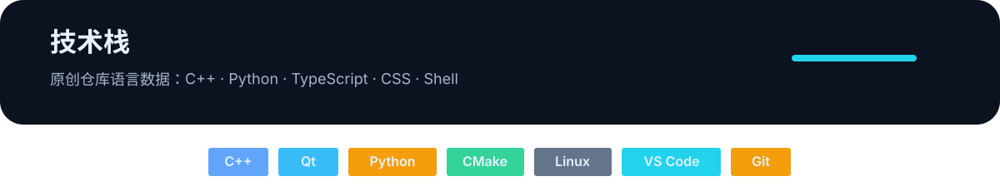
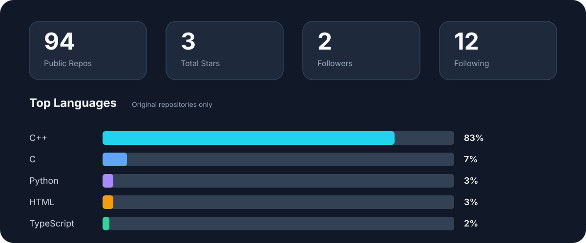
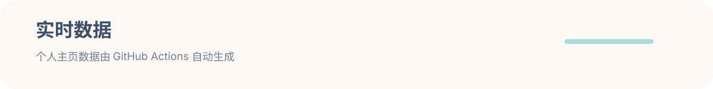

  {{GITEE_BLOCK}}

  

## 关于我

{{BIO}}

  

## 技术栈

  

## GitHub 概览

  

## 精选项目

{{PROJECT_SECTIONS}}

## 个人亮点

  

  

## 贡献活动

### 3D 贡献图

  

### 动态贡献贪吃蛇

  

## 联系我

- GitHub：[{{USERNAME}}](https://github.com/{{USERNAME}})
{{TELEGRAM_BLOCK}}
